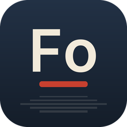

<p align="center">
  
</p>

<h1 align="center">Foto · Suíte FisiLab</h1>

<p align="center">
  <b>Editor de imagens</b><br>
  Alternativa livre ao <b>Adobe Photoshop</b>
</p>

<p align="center">
  Disponibilizado pelo <b>FisiLab — LARFIC · UFRGS</b> em parceria com o <b>CTA — Centro de
  Tecnologia Acadêmica</b>, para democratizar o acesso à tecnologia entre os alunos da UFRGS.
</p>

---

O Foto faz parte da [Suíte FisiLab](https://github.com/mrcandrade/larfic/tree/main/suite-fisilab):
programas livres para ensinar, pesquisar e criar na universidade. Ele é uma versão modificada do
[PhotoCraft](https://github.com/storytold/photocraft), um editor de imagens nativo escrito em Rust.

## O que faz

- **Camadas de verdade:** grupos, máscaras de pixel e vetoriais, máscaras de recorte, camadas de
  preenchimento, objetos inteligentes com filtros inteligentes e 27 modos de mesclagem.
- **Edição não destrutiva:** 16 camadas de ajuste (Curvas, Níveis, Vibratilidade, Matiz/Saturação,
  Preto e Branco, Mapa de Gradiente, entre outras) e estilos de camada ao vivo (sombra, brilho,
  bisel, contorno, sobreposições).
- **Arquivos PSD e PSB:** abre, edita e salva documentos em camadas do Photoshop; também lê e grava
  TIFF em camadas e OpenRaster, e lê Krita (`.kra`) e Paint.NET (`.pdn`), além de PNG, JPEG, WebP,
  EXR e outros formatos comuns.
- **Seleções inteligentes:** letreiros, laços, Varinha Mágica, Seleção Rápida, Seleção de Objeto e
  Selecionar e Mascarar, tudo processado no próprio computador, sem nuvem e sem conta.
- **Texto, vetores e pincéis:** texto de ponto e de parágrafo editável na tela, ferramentas de forma
  e Caneta, e um motor de pincéis com pressão, inclinação e rotação da caneta.
- **Filtros com prévia ao vivo:** desfoques (incluindo a Galeria de Desfoque), nitidez, redução de
  ruído, distorções e muito mais, com prévia na tela.
- **Cores de verdade:** documentos RGB, Escala de cinza, CMYK e Lab em 8, 16 e 32 bits por canal,
  com gerenciamento de cores ICC e prova de cores na tela.
- **Automação:** cada ação é um comando, então o mesmo motor pode ser usado pela interface, pela
  linha de comando (`fisilab-foto-cli`), por ações gravadas, em lote ou por um servidor MCP.

## Instalação

### Windows

Baixe o instalador `FisiLab-Foto-Setup-<versão>.exe` no portal de downloads da Suíte FisiLab ou na
página de [versões do Foto no GitHub](https://github.com/mrcandrade/fisilab-foto/releases) e execute-o.
O Foto abre em português do Brasil, com a paleta original do PhotoCraft (tema **Noite**; o tema claro **Dia** e os
demais temas estão em *Janela › Tema*).

### Compilar a partir do código

É preciso ter o [Rust](https://www.rust-lang.org/pt-BR/tools/install) instalado.

```sh
git clone https://github.com/mrcandrade/fisilab-foto
cd fisilab-foto
cargo run --release -p photocraft --features heif -- imagem.psd   # o aplicativo (fisilab-foto.exe)
cargo run --release -p photocraft-cli --features heif -- --help    # a linha de comando (fisilab-foto-cli.exe)
```

Os pacotes Cargo mantêm os nomes originais (`photocraft`, `photocraft-cli`); os executáveis gerados
se chamam `fisilab-foto` e `fisilab-foto-cli`. A opção `--features heif` (fotos HEIC/HEIF) é a mesma das
versões oficiais.

## Créditos

O Foto é baseado no [PhotoCraft](https://github.com/storytold/photocraft), criado pela
**ArtCraft Team e contribuidores do PhotoCraft**. Todo o trabalho de edição, formatos de arquivo e
ferramentas é deles; o FisiLab alterou o nome, a identidade visual, o tema de cores, a tela de
abertura, os links e o idioma padrão (veja [MODIFICACOES.md](MODIFICACOES.md)).

O código é distribuído sob a licença [MIT](LICENSE-MIT) ou [Apache 2.0](LICENSE-APACHE), à escolha
de quem o usa. Os avisos obrigatórios estão em [NOTICE](NOTICE), os materiais de terceiros (fontes,
ícones etc.) em [ATTRIBUTION.md](ATTRIBUTION.md), e o README original em
[README.upstream.md](README.upstream.md).

Os nomes e marcas do projeto original (PhotoCraft, ArtCraft) e de outros produtos citados (Adobe
Photoshop) pertencem aos seus titulares. Esta versão não é afiliada nem endossada por eles.

## Manifesto

Conhecimento produzido em uma universidade pública deve circular livremente, e as ferramentas que
usamos para ensinar, pesquisar e criar também devem ser livres: leia o
[Manifesto pelas tecnologias livres](https://github.com/mrcandrade/larfic/blob/main/suite-fisilab/MANIFESTO.md).

---

<p align="center">
  <a href="https://www.ufrgs.br"></a>
  &nbsp;&nbsp;&nbsp;
  <a href="https://cta.if.ufrgs.br"></a>
  &nbsp;&nbsp;&nbsp;
  
  <br>
  <sub>FisiLab — LARFIC · UFRGS, em parceria com o CTA — Centro de Tecnologia Acadêmica</sub>
</p>
